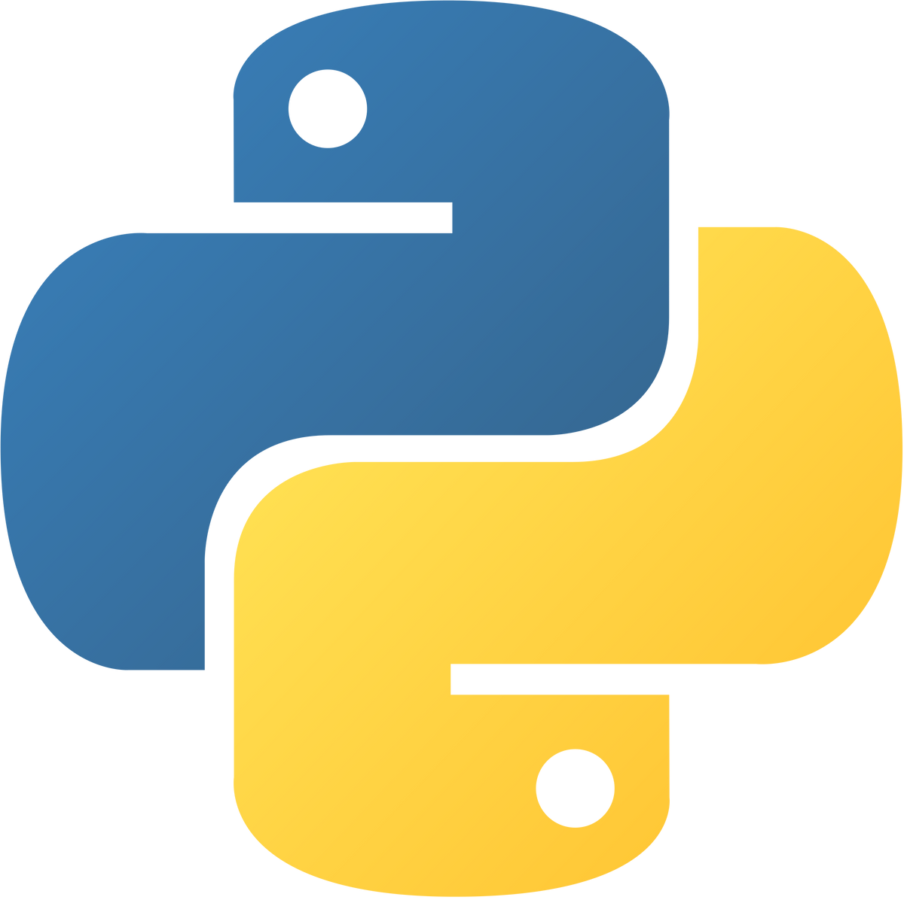
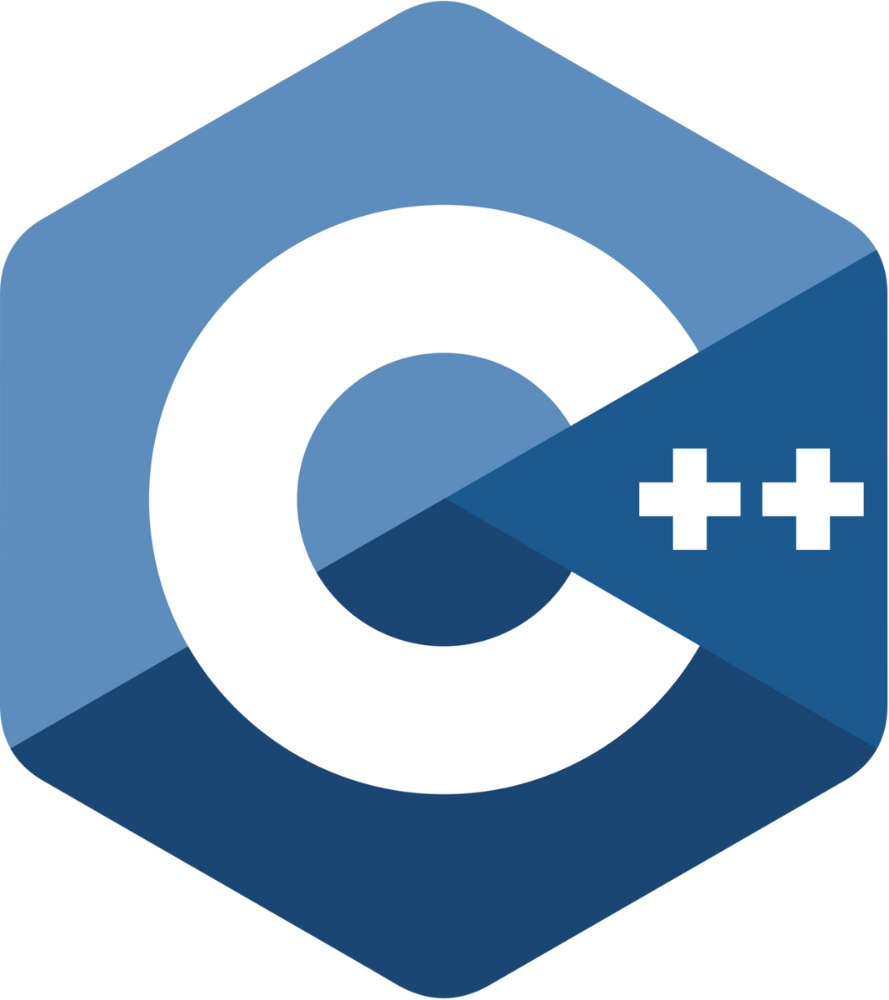
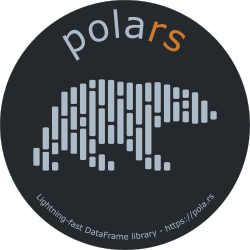
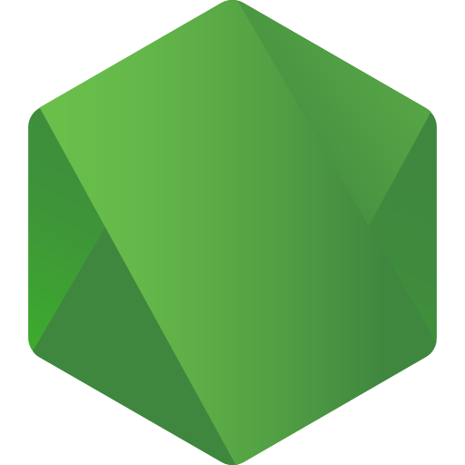
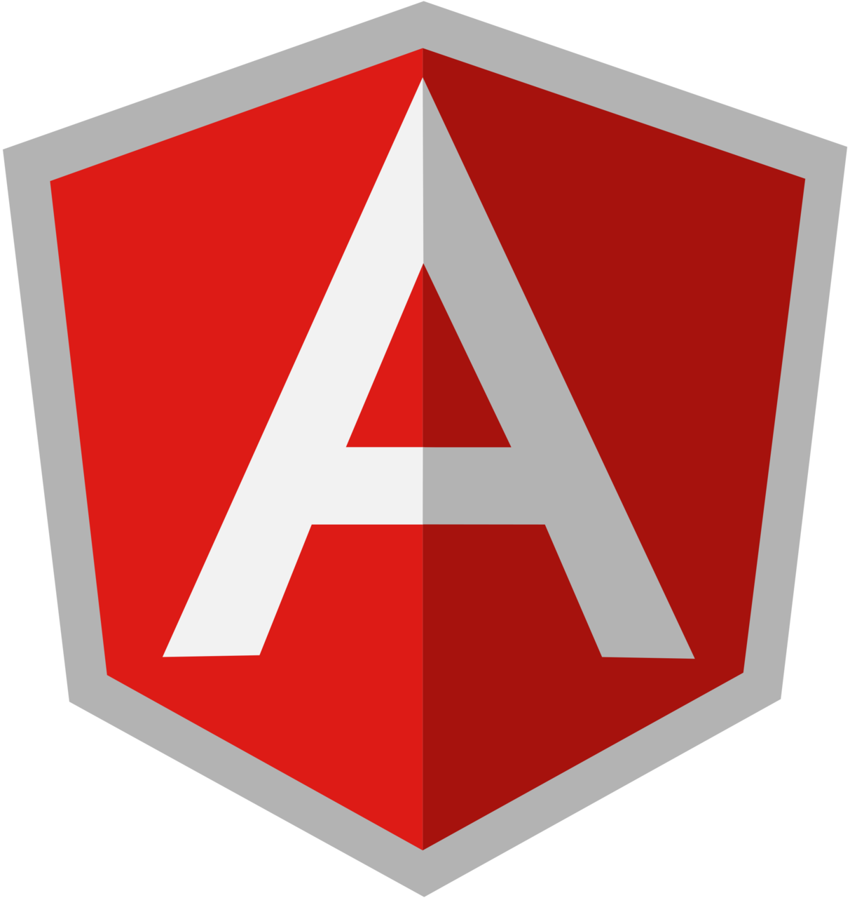
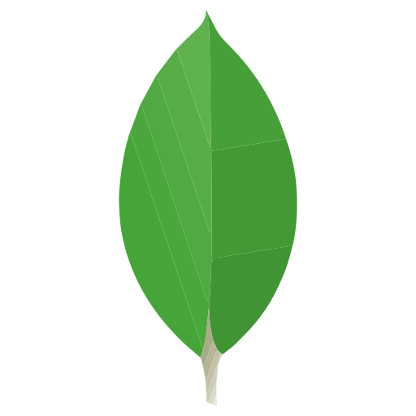
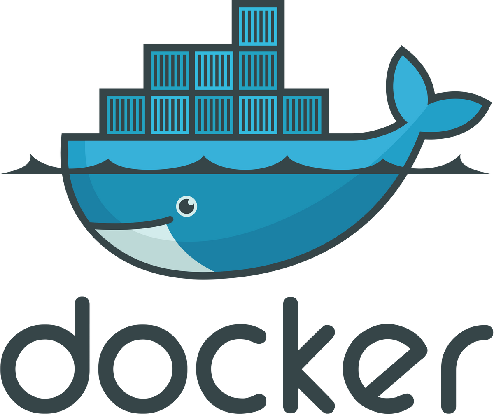

# Hi, I'm Carlos

Software engineer from Málaga who mostly builds backend systems. I have always loved astronomy, so I ended up doing an MSc in Astrophysics & Astronomy, and these days I spend my free time analysing astronomic data and playing around with embedded systems.

* Backend enjoyer
* Stargazer who ended up crunching telescope data
* Obsessed with fast, observable & reliable systems
* Functional programming <3
* Happier when Rust

## Languages & Tools

    <!-- Rust -->
    
    <!-- Java -->
    
    <!-- Python -->
    
    <!-- TypeScript -->
    
    <!-- JavaScript -->
    
    <!-- C -->
    
    <!-- C++ -->
    
    <!-- Haskell -->
    

    <!-- Tokio -->
    
    <!-- Polars -->
    
    <!-- Spring Boot -->
    
    <!-- FastAPI -->
    
    <!-- Node.js -->
    
    <!-- Angular -->
    
    <!-- React -->
    
    <!-- Vue -->
    

    <!-- PostgreSQL -->
    
    <!-- MongoDB -->
    
    <!-- Redis -->
    
    <!-- RabbitMQ -->
    

    <!-- Docker -->
    
    <!-- Grafana -->
    
    <!-- Prometheus -->
    
    <!-- OpenTelemetry -->
    
    <!-- Kubernetes -->
    
    <!-- Helm -->
    
    <!-- Google Cloud -->
    
    <!-- Airflow -->
    

    <!-- Arch -->
    
    <!-- uv -->
    
    <!-- Vim -->
    
    <!-- VSCode -->
    
    <!-- Jetbrains -->
    
    <!-- UML -->
    

## Learning Next

    <!-- Crystal -->
    
    <!-- Elixir -->
    
    <!-- Lua -->
    
    <!-- Go -->
    

